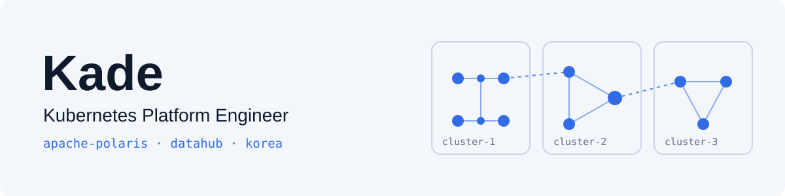
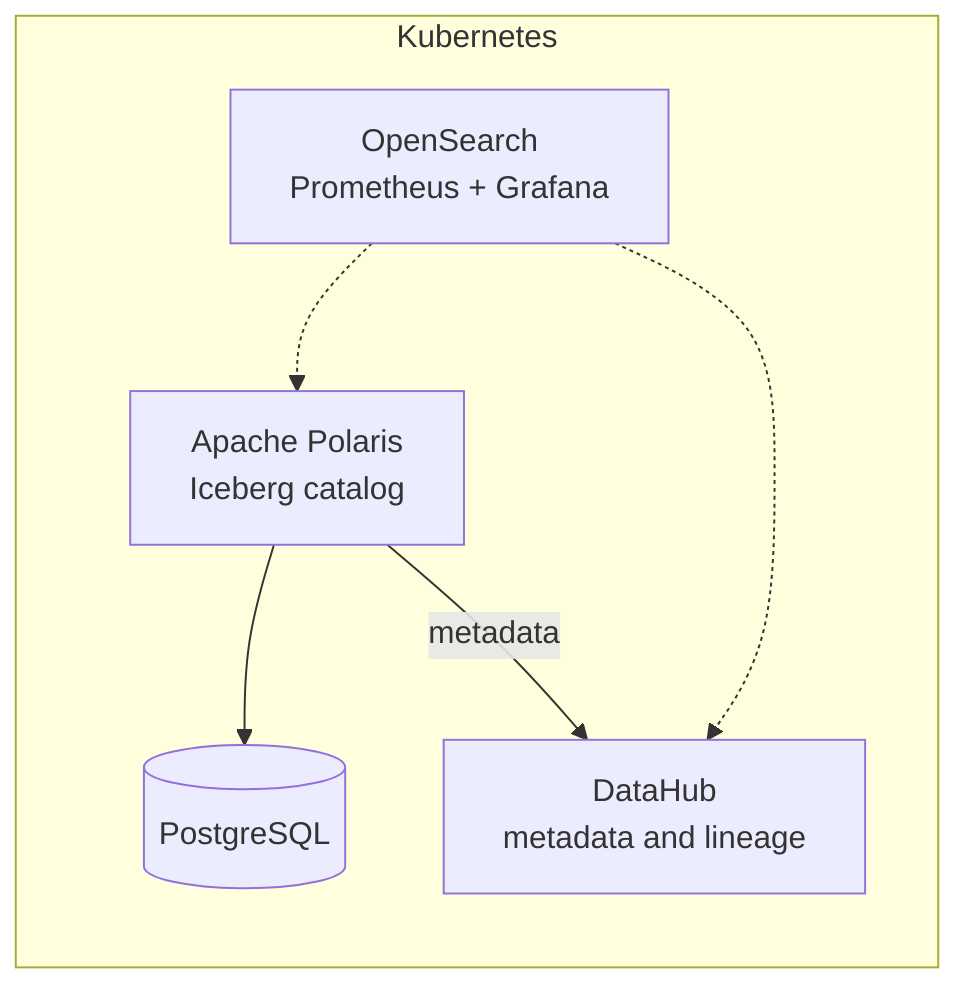

<picture>
  <source media="(prefers-color-scheme: dark)" srcset="assets/banner-dark.svg"/>
  
</picture>

I'm a Kubernetes platform engineer in Korea. I run a data platform on Kubernetes: Apache Polaris as the Iceberg catalog, DataHub for metadata and lineage, and OpenSearch, Prometheus and Grafana to watch it all.

한국어 소개

쿠버네티스 위에서 Apache Polaris와 DataHub 기반 데이터 플랫폼을 운영하는 플랫폼 엔지니어입니다. 퇴근 후에는 2D 액션 게임 Stella Rain, 일본어→한국어 실시간 채팅 번역기 resonance-stream, 그리고 코딩을 돕는 AI 에이전트 설정을 만들고 있습니다.

### Now

- Running Apache Polaris and DataHub on Kubernetes at work
- Training the JA → KO model behind resonance-stream
- Building Stella Rain, one combat system at a time

### The platform, simplified

### Projects

- **[kade-k8s-platform](https://github.com/enjay27/kade-k8s-platform)**: a mock of that data platform, running across 3 Kubernetes clusters.
- **[resonance-stream](https://github.com/enjay27/resonance-stream)**: real-time chat translator, Japanese → Korean, with a fine-tuned LLM.
- **Stella Rain**: 2D quarter-view action game. In development, private for now.
- **[kade-agent](https://github.com/enjay27/kade-agent)**: rules, skills and configs for my AI coding agents.

### How I work with AI agents

My agents follow one rule set, kept in [kade-agent](https://github.com/enjay27/kade-agent):

- Plan first: no edits until the plan is approved
- Test first: a failing test before every fix
- Every change runs its checks; anything not verified is named as such
- Agents author their own commits; I review and merge

### Stack

| Area | Daily |
| --- | --- |
| Platform | Kubernetes, PostgreSQL |
| Data catalog | Apache Polaris, DataHub |
| Observability | OpenSearch, Prometheus, Grafana |

Before platform work

Java / Spring, TypeScript / NestJS, Python / FastAPI, React, Flutter, Keycloak, OAuth2, Redis, MongoDB, MinIO, MLflow, DVC, Docker, GitHub Actions, GitLab CI, Jenkins, Nginx

X [@kade027](https://x.com/kade027)
