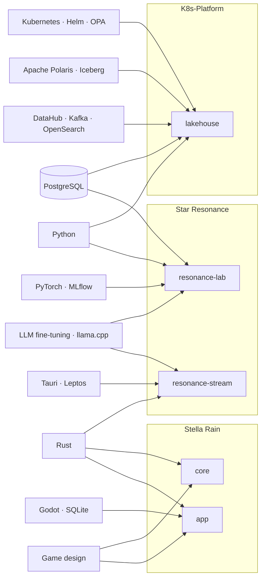

<picture>
  <source media="(prefers-color-scheme: dark)" srcset="assets/banner-dark.svg"/>
  
</picture>

Kubernetes platform engineer in Korea. At work I run a data platform on Kubernetes built around Apache Polaris and DataHub. After hours I build a game, a live translator, and the agents that help me code.

한국어 소개

K8s 데이터 플랫폼에서 Apache Polaris와 DataHub를 운영하는 플랫폼 엔지니어입니다. 퇴근 후에는 2D 액션 게임 Stella Rain, 일본어→한국어 실시간 채팅 번역기 resonance-stream, 그리고 코딩을 돕는 AI 에이전트 설정을 만들고 있습니다.

### Now

- Running Apache Polaris and DataHub on Kubernetes at work
- Training the JA → KO model behind resonance-stream
- Building Stella Rain, one combat system at a time

### Projects

- **[K8s-Platform](https://github.com/kade-k8s-platform)**: a mock data platform running across 3 Kubernetes clusters.
- **[Star Resonance](https://github.com/star-resonance)**: real-time chat translator, Japanese → Korean, with a fine-tuned LLM.
- **[Stella Rain](https://github.com/stella-rain)**: 2D quarter-view action game. The app is private; its simulation core is open source.
- **[Kade Agent](https://github.com/kade-agent)**: rules, skills and configs for my AI coding agents.

### How I work with AI agents

My agents follow one rule set, kept in [Kade Agent](https://github.com/kade-agent):

- Plan first: no edits until the plan is approved
- Test first: a failing test before every fix
- Every change runs its checks; anything not verified is named as such
- Agents author their own commits; I review and merge

### Stack

| Area | Daily |
| --- | --- |
| Platform | Kubernetes, PostgreSQL |
| Data catalog | Apache Polaris, DataHub |
| Observability | OpenSearch, Prometheus, Grafana |

X [@kade027](https://x.com/kade027)
